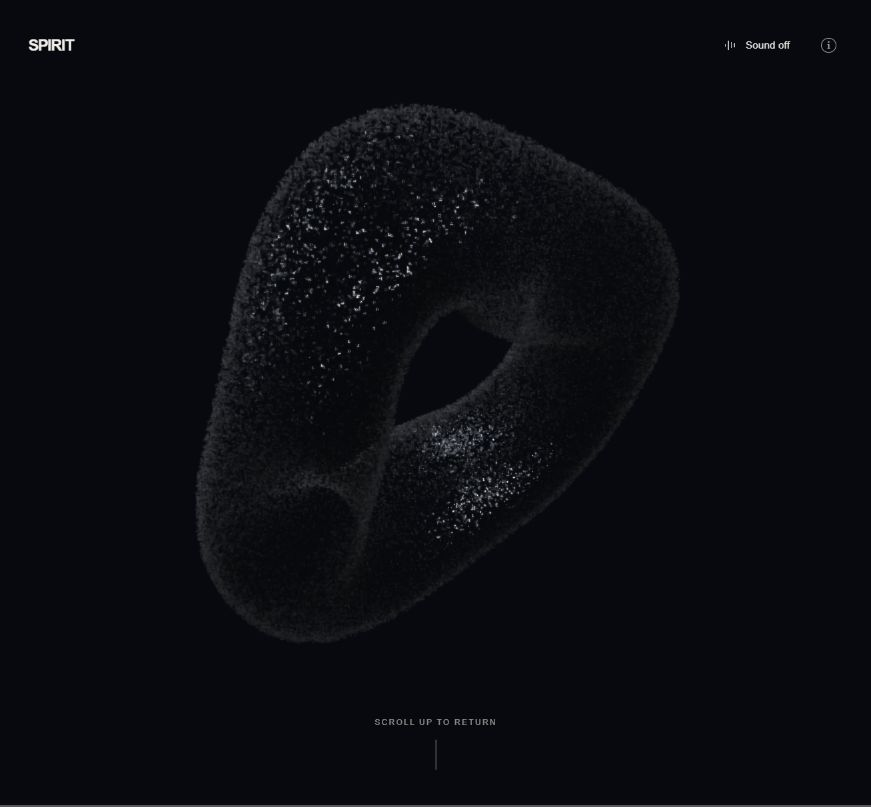

# DARK MATTER

A cinematic WebGL particle experience by Mirhazar Khan, built on The Spirit. GPU-driven particles flow through an ivory introduction, a slow-motion title reveal, a red tail-follow scene, and a living silver ring.



Scroll or swipe to start each cinematic transition. Each scene holds until the next gesture. At the silver ring, click and hold to unfold red, violet and blue particle ribbons; the supplied drum recording triggers a burst into silver **DARK / MATTER** lettering. Releasing before the impact returns to the ring. Keyboard navigation, Space hold, Enter playback, sound controls and reduced-motion support are included.

## Run locally

```sh
npm ci
npm run dev
```

Open the local address printed by the server, normally `http://localhost:4000/`.

```sh
npm run build
npm test
```

The production build writes `app/js/index.js`. Serve the `app/` directory as a static site. The repository includes the portrait, soundtrack and generated production bundle. The included Vercel configuration uses `app/` as its output directory.

The build and all 70 automated checks pass. Live visual and audible verification of the latest hold finale remains outstanding because the browser-control security policy blocked the local preview. See the [engine guide](docs/SPIRIT_ENGINE.md) for timing, architecture and the verification scope.

## Restore Checkpoint A

The `checkpoint-a` tag preserves the earlier accepted experience. To inspect it without changing the current branch, create a separate checkout:

```sh
git worktree add ../darkmatter-checkpoint-a checkpoint-a
```

## Credits and license

Original WebGL experiment: [The Spirit](https://github.com/edankwan/The-Spirit) by Edan Kwan. Particle technique: [The New Particle](http://www.simppa.fi/blog/the-new-particle/) by Simo Santavirta. The original experiment was also inspired by David Li's Flow.

The original code is provided under the [MIT license](LICENSE.md). Preserve its copyright and permission notice when distributing it.

