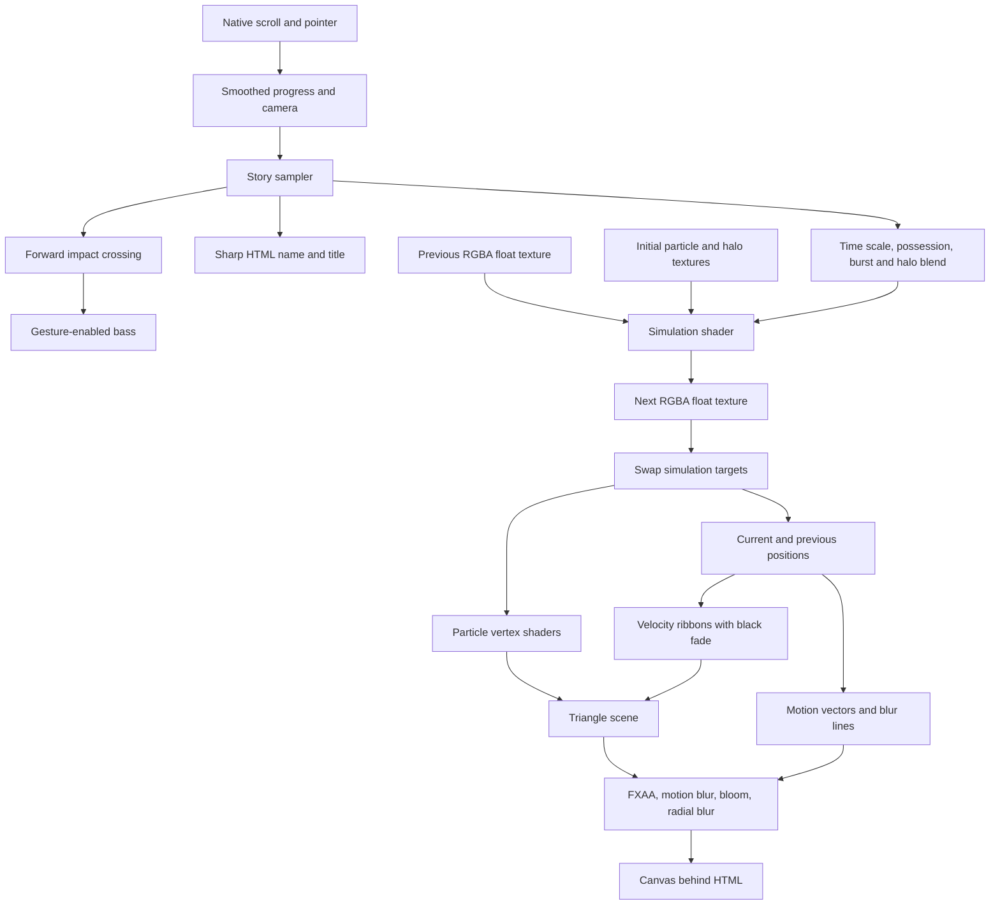

# Spirit engine reference

Spirit is a cinematic particle experience controlled by native page scrolling.
Particles arrive on an ivory stage with the name **MIRHAZAR KHAN**, accelerate as the viewer moves forward, then enter a dark, slow-motion scene revealing **DARK MATTER**.
Continuing to scroll wipes **DARK** to the right and **MATTER** to the left. A branching red front spreads through the particle volume, revealing sharp red heads with tails fading to black. Once the possession completes, the camera rises along an arc to reveal the ring from above.
The fixed interface contains a small Spirit signature, sound toggle, credits and contextual scroll cues.
This guide describes the source inspected on 2026-10-09.

## Verification scope

The current production build passes. The controller, story sampler, spherical camera path, possession shader, sound module, morph-target helpers, trail shaders and GPU architecture have been inspected for this guide. Current checks cover 10,001 finite phase samples, 3,003 spherical camera poses, 160,016 composed camera poses across eight aspect ratios and both motion modes, and 823,296 fixed-identity possession masks for finite, bounded and monotonic values, including the final front-distance mapping. The composed path preserves the chapter seam, monotonically pulls back during possession, retains the final framing and adds no dolly or arc under reduced motion.
Before adding the red chapter, the live in-app browser rendered the GPU particles, opening name, surrounding blur and Dark Matter title. The opening and title were checked at 1440×900 and the sequence at 365×616, with no horizontal overflow at either size. Sound activation, credits and keyboard replay were exercised without new console errors.
Holding the original opening progress at 0.648 completed the impact beat: the title reached full opacity and the simulation reached 0.14× without further input. That position now maps to global progress 0.324. Earlier pure phase checks covered 10,001 progress samples and the timed beat; mocked audio checks covered unlock, cancellation, cooldown, voice limits and cleanup. These checks do not measure frame rates across devices or independently assess the audible mix.
The current possession and ascent render in the live in-app browser at 365×616 and 1440×900 without shader errors or horizontal overflow. Mid-transition captures show distinct silver and red regions as the front moves through the volume. At full scroll, inspection reports complete possession, 52° camera elevation and 18° azimuth; the upper view reveals the ring's opening and depth at both sizes. Proof is saved as `cinematic-possession-mobile.jpg`, `cinematic-possession.jpg`, `cinematic-red-ascent-mobile.jpg` and `cinematic-red-ascent.jpg` beside this guide. Temporary desktop viewport overrides were reset after testing.
The earlier red chapter was also checked for opposing word transforms, blur and trailing shadows at both sizes; scrolling backward restored the title and silver palette. The settled red scene reached 0.82× speed with a fully completed wipe, sharp red heads and tapered tails. Its older captures, `cinematic-red-wipe-mobile.jpg`, `cinematic-red-wipe.jpg` and `cinematic-red-particles.jpg`, predate the spatial possession and upward camera arc. Run the production build after source changes and verify changes in a browser.
The retained [particle-forms.png](particle-forms.png) illustrates earlier target positions using a CPU projection; it is not a screenshot of this cinematic experience.

## Engine map

| File or directory | Responsibility | Useful extension point |
| --- | --- | --- |
| [src/index.js](../src/index.js) | Startup, scroll input, camera travel, choreography, interface, frame loop and teardown | App lifecycle and public control API |
| [src/core/cinematic.js](../src/core/cinematic.js) | Pure scroll-progress sampler, easing, impact point and simulation time scale | Sequence timing and additional reveals |
| [src/core/cameraPath.js](../src/core/cameraPath.js) | Spherical camera ascent, side angle and aspect-aware framing | Camera choreography without changing the lens |
| [src/core/sound.js](../src/core/sound.js) | Gesture-enabled Web Audio bass impact and resource cleanup | Sound design and additional cues |
| [src/core/settings.js](../src/core/settings.js) | Shared settings, target uniforms and hash parsing | Validated presets and quality profiles |
| [src/3d/morphTargets.js](../src/3d/morphTargets.js) | Deterministic cinematic halo, optional text, object and portrait targets | New forms and image sampling |
| [src/3d/simulator.js](../src/3d/simulator.js) | Float-texture simulation and target swapping | Force uniforms and simulation readiness |
| [src/glsl/position.frag](../src/glsl/position.frag) | Lifetime, respawn, attraction, curl, burst and formation | Force fields and emission patterns |
| [src/glsl/helpers/curl4.glsl](../src/glsl/helpers/curl4.glsl) | Curl field derived from noise | Original smoky movement |
| [src/3d/particles.js](../src/3d/particles.js) | Points, alternating triangle geometry and motion materials | Particle appearance |
| [src/3d/particleTrails.js](../src/3d/particleTrails.js), [src/glsl/particleTrails.vert](../src/glsl/particleTrails.vert), [src/glsl/particleTrails.frag](../src/glsl/particleTrails.frag) | GPU velocity ribbons, depth handling and red-to-black tail shading | Particle tails without blurring their heads |
| [src/glsl/helpers/possessionMask.glsl](../src/glsl/helpers/possessionMask.glsl) | Shared radial/tendril possession front for particle heads and tails | Spatial palette changes through a moving volume |
| [src/3d/postprocessing/cinematic](../src/3d/postprocessing/cinematic) | Radial peripheral blur and subtle color separation | Surrounding motion treatment |
| [src/3d/postprocessing](../src/3d/postprocessing) | Composer, anti-aliasing, motion vectors, blur and bloom | Quality scaling and visual finish |
| [src/3d/fboHelper.js](../src/3d/fboHelper.js) | Full-screen shader passes and render targets | GPU buffer utilities |
| [src/3d/lights.js](../src/3d/lights.js) | Scene lighting | Light staging |
| [app/index.html](../app/index.html), [app/css/index.css](../app/css/index.css) | Fixed cinematic overlay, crisp typography and native scroll spacer | Product presentation |
| [app/js/three.r74.min.js](../app/js/three.r74.min.js) | Global Three.js runtime | Version boundary for any migration |
| [src/libs/global_three/index.js](../src/libs/global_three/index.js) | Exposes global `THREE` to source modules | HTML script load order |
| [dev.js](../dev.js), [build.js](../build.js) | Development serving and production bundling | Build and preview behavior |

The actual global runtime is Three.js r74; the local package metadata says 0.73.0.
Source modules use that global runtime rather than loading a second Three.js implementation.
The HTML loads `three.r74.min.js` before `index.js`.
Custom shaders use version-specific chunks, so upgrading Three.js requires a deliberate material and postprocessing port.
The old dat.GUI shell, five-chapter `journey.js`, OrbitControls, floor and mobile warning module remain in the repository but are not used by the current entry point.

## Scroll choreography

A 700vh scroll spacer, overridden by 700svh where supported, provides six viewport heights of travel below the initial viewport.
The canvas and interface remain fixed while `readScroll()` normalizes the document scroll position to 0–1.
The original sequence occupies global progress 0–0.5, preserving its first three viewport heights of travel; its opening progress is `min(1, progress / 0.5)`.
The extended chapter occupies the remaining three viewport heights, using `chapterProgress = max(0, (progress - 0.5) / 0.5)` and `nextProgress = min(1, chapterProgress * 1.5)`.
The latter retains the red handoff's original two viewport heights while reserving the final travel for the ascent.
The controller eases toward the global position with an approximately 145 ms response; scroll velocity is normalized by the opening's 0.5 share to preserve its blur response.
There is no automatic timeline playback.

| Global progress | Implemented behavior |
| --- | --- |
| Arrival at the beginning | A 3.2-second particle arrival envelope reveals the centered two-line name on ivory. Reduced motion uses immediate arrival. |
| 0.030–0.150 | The name fades, moves upward and softens as the viewer departs. |
| 0.060–0.385 | A rush envelope accelerates the simulation and increases motion treatment; its entrance completes at 0.190 and its exit starts at 0.290. |
| 0.065–0.325 | The camera moves closer to the particle scene. Small pointer and ambient camera offsets provide parallax. |
| 0.120–0.300 | Background, fog and particle colors transition from ivory and ink to near-black and pale light. The rush reaches the dark stage before impact. |
| 0.320 | Crossing forward triggers a particle burst, brief camera impulse and bass thump when sound is enabled. |
| 0.310–0.400 | The scroll envelope slows simulation toward 0.14 of normal frame time; the timed impact beat can complete braking sooner. |
| 0.330–0.450 | The scroll envelope reveals the white **DARK / MATTER** heading; the timed impact beat can complete the reveal without further scrolling. |
| 0.320–0.470 | Particles gradually gather toward a tilted halo, with formation strength reaching 0.42 through scroll or the impact beat. |
| 0.500 | The next chapter begins from the fully revealed title and unchanged camera position. |
| 0.513–0.700 | The title's wipe envelope moves **DARK** right and **MATTER** left; brief stretching, blur and trailing text shadows peak mid-wipe. Details fade earlier, and the words fade during the latter half of the wipe. |
| 0.533–0.717 | A radial, branching red front spreads through the volume. Possessed heads turn `#ff0204`, their lifetime fade becomes black, and their velocity ribbons appear. The halo also changes its tilt toward the future upper camera. Canvas blur and bloom clear during the early part of possession, keeping affected red heads crisp while the front spreads. |
| 0.607–0.783 | Simulation time scale rises from 0.14 toward 0.82. |
| 0.740–1.000 | After red reaches its full strength, the camera climbs to a 52° elevation and an 18° side angle around the same scene center. Formation rises from 0.315 to 0.415 to keep the upper ring coherent. |

The impact fires once on a forward crossing of `cinematic.impactPoint` (0.320).
Returning below `cinematic.rearmPoint` (0.190) rearms it for another forward crossing.
After that crossing, a real-time beat finishes even when the viewer stops scrolling: the scene becomes fully dark in 0.7 seconds, simulation reaches the 0.14 time scale in 0.9 seconds, and the title finishes revealing in 1.5 seconds.
Rush and its blur contribution taper as braking completes; the brief burst and camera impulse also decay in real time.
Reversing toward the opening releases the timed beat smoothly through a global progress mask from 0.320 down to 0.270.
Opening a restored page at or beyond 0.320 initializes the same visual beat. Audio remains silent until enabled from the sound control.
Name and Dark Matter typography are HTML layers, so the title remains sharp while the surrounding canvas receives postprocessing.
The introduction can blur as it departs. Dark Matter's opposing departure uses its own HTML blur, leaving particle-head sharpness independent of the text treatment.

`cinematic.sample(progress, reducedMotion, impactAge)` returns `progress`, `openingProgress`, `chapterProgress`, `nextProgress`, `departure`, `rush`, `darkness`, `reveal`, `timeScale`, `formation`, `travel`, `nameOpacity`, `wipe`, `red`, `arc` and `handoffRush`.
It clamps progress and uses smoothstep easing.
The optional finite `impactAge` is elapsed time in seconds since the active impact; omitting it samples only the scroll envelopes.
Within `nextProgress`, `wipe` eases over 0.04–0.60, `red` over 0.10–0.65, and a mild `handoffRush` enters over 0.02–0.25 and leaves over 0.55–0.82.
Time scale blends toward 0.82 over local 0.32–0.85 after the impact beat is applied. Formation eases from 0.42 to 0.315 as red settles, then adds `arc * 0.10` during the climb. `arc` uses the longer `chapterProgress` and eases over 0.48–1.00.
During possession, the controller gently increases narrow-screen distance toward `max(distance, 480 / max(0.35, aspect))` over `smoothstep(0.05, 0.60, red)`, preserving the opening and desktop distance. Reduced motion skips this pullback.
`cameraPath.sample(distance, aspect, arc)` converts the arc envelope into spherical coordinates about `(0, 50, 0)`. Its elevation is `arc * 52°`, azimuth is `arc * 18°`, and radius blends toward `max(distance * 1.10, 540 / max(0.35, aspect))`. A 1440×900 stage finishes near radius 591; a 365×616 stage near 911. The latter pulls back further so the opened ring stays within the narrow frame. The camera keeps the same 45° lens, center and vertical up vector throughout.
Reduced motion disables both rush envelopes, camera travel, ascent, parallax and visual impulses, sets simulation time scale to 0.16, and retains the color and title reveals. The title's next-scene departure becomes an opacity fade without horizontal travel, stretching or blur.

## Rendering flow



Each simulation texel stores XYZ position and lifetime in RGBA.
Initial particle positions are generated once on the CPU.
Every active simulation frame, a full-screen fragment shader reads the previous state and writes the next state to a second float render target.
Expired particles respawn near the animated attractor, with their spawn positions blended toward the halo as formation increases.
Surviving particles receive attraction, curl displacement, a transient outward burst and a delta-adjusted pull toward the target.
Formation retains curl and drift rather than freezing the particles into a rigid object.
The buffers swap, so particle motion does not require CPU position uploads each frame.

Both points and triangle meshes are created at startup; the cinematic controller selects triangles throughout this sequence.
Triangle orientation alternates between geometry variants, and current/previous simulation positions also feed custom motion materials.
The opening halo and ascending halo are lazily generated float textures matching the simulation dimensions, with stable seeded particle identity and constant alpha 1. Both consume the same random values, so matching texels represent the same particle in both targets.
The ascending target reflects the opening halo about `(0, 50, 0)` along the initial camera basis normal. With this entry point's initial camera basis, X/Y remain unchanged and Z is negated. This reverses the tilt toward positive Y while preserving the initial projected silhouette. `targetMix = red` changes the tilt before the climb, preventing the upward camera path from crossing the original ring nearly edge-on.
Simulation lifetime remains separate from target alpha.
The controller uses an automatic attractor; pointer movement subtly offsets the camera rather than directly dragging particles.

The red transition is evaluated per particle in the GPU vertex shaders through the shared `possessionMask` helper. It measures weighted radial distance from `(0, 50, 0)`, adds two angular tendril waves and stable identity grain, and uses a narrow smoothstep band around each particle's arrival threshold. Its front distance is mapped through `(distance - 20) / 170` to spread the takeover across the actual halo radius. At the same scroll position, inner lobes can be fully red while outer particles remain silver; the whole field does not pass through one uniform pink palette.
The mask is exactly 0 at possession 0 and exactly 1 at possession 1. It depends on live world positions, so fluid movement continues through the advancing front. Reversing scroll retracts the front. Heads and tails sample the same position and identity, keeping their possession state aligned.
The base head/fade uniforms retain the ivory-to-silver opening palette. Possessed heads instead use `possessionColor` with lifetime fade toward black. The controller does not globally interpolate those uniforms toward red.

`particleTrails` adds a stable subset of at most 32,768 GPU ribbons, each represented by two triangles. It reads the current and previous simulation textures directly, with no per-frame CPU position upload.
The vertex shader derives a camera-facing planar direction from particle displacement, divides its length by simulation delta relative to 16.6667 ms, and caps tail length at 26 world units. Slow motion therefore slows movement without removing the tails.
Ribbons sit 0.8 view-space units behind the head plane. They use normal alpha blending, depth testing and no depth writes; opaque particle heads retain their sharp silhouette and depth occlusion.
Tail color and opacity fade toward black and transparency, with soft side edges. Their color uniform shares `possessionColor` with the heads; their opacity is gated by both overall tail strength and each particle's possession mask, so a silver head cannot acquire a red tail ahead of the front.
Respawn lifetime jumps, displacements of 48 units or more and stationary particles suppress ribbons. Trails are hidden at zero simulation delta and release their references during scene teardown.

The composer runs enabled effects in this order: FXAA, supported motion blur, bloom, then cinematic radial blur.
Motion blur requires floating-point textures with linear filtering.
The radial pass samples toward the screen center more strongly at the perimeter, so movement concentrates in the surroundings.
Bloom becomes active as darkness passes 0.45 and uses the existing screen-blended softening pass; it is not selective HDR bloom.
During the next chapter, blur distances, motion multiplier, radial strength and bloom amount are multiplied by `1 - smoothstep(0.02, 0.45, red)`. Blur and bloom therefore clear before possession is halfway complete, so the advancing red front and its affected heads are sharp. Bloom and radial blur turn off, while the motion pass remains active at zero strength to keep previous camera matrices current for reverse scrolling and camera ascent.
Reduced motion disables motion blur, bloom and radial blur.
FXAA remains enabled. Shadow maps are disabled in this cinematic version.
DOF and vignette modules remain available but are not wired into the sequence.
Resize updates the camera, canvas, composer buffers and effects through `effectComposer.resize`.

## Interface and settings

| Control | Implemented behavior |
| --- | --- |
| Scroll / touch swipe / native page keys | Moves forward or backward through the scene |
| SPIRIT signature | Smoothly returns to the beginning; immediate under reduced motion |
| Sound off / on | Enables the audio context from a user gesture, or fades sound out |
| Information icon | Opens the credits and brief instructions |
| Close / Escape | Closes credits and returns focus to the information control |

Audio is off initially.
Importing `sound.js` does not create an audio device; clicking Sound invokes `enable()` and resumes the context if needed.
If the viewer enables sound after the impact point, the controller plays a lower-strength confirmation thump.
The effect is synthesized locally from a falling sine tone and low-pass noise, with a limited number of concurrent voices and a short cooldown.
Disabling sound fades its master gain; teardown stops active sources, disconnects nodes and closes the context.
There are no downloaded audio assets or background soundtrack.

| Engine setting | Current controller ownership |
| --- | --- |
| `query.amount` | Desktop `65k`, mobile `16k`; valid hash values override either |
| `useTriangleParticles`, `followMouse` | true and false respectively |
| `intensity` | `0.65 + rush * 0.3 + red * 0.15` |
| `speed` | `0.85 + rush * 0.45 + red * 0.15`, then multiplied by simulation delta |
| `dieSpeed` | 0.012, then multiplied by simulation delta |
| `radius` | `0.9 + rush * 1.0` |
| `curlSize` | `0.019 - rush * 0.004` |
| `attraction` | `0.8 - rush * 0.5` |
| `burst` | Decaying impact impulse × 0.85 |
| Target textures / mix / strength | Opening halo to ascending halo, blend `red`, sampled formation up to 0.42; settles to 0.315 before rising to 0.415 during ascent |
| Background / fog | `#f4f2ec` to `#07080d` |
| Base particle head / lifetime fade | `#777875` to `#bbc2d5`; fade color blends toward the dark background |
| `possession` / `possessionColor` | Sampled `red` drives a per-particle front; possessed color is `#ff0204` with lifetime fade to black |
| Interface ink | `#15161a` to `#eeece7` |
| `tailStrength` | Sampled `red`, from 0 to 1 |
| `fxaa` | Enabled |
| `motionBlur` | Enabled when supported and reduced motion is off |
| Motion-blur distance | `(16 + rush * 125 + handoffRush * 35 + impact * 24) * sharpness`, where `sharpness = 1 - smoothstep(0.02, 0.45, red)` |
| Motion-blur multiplier | `(0.35 + rush * 3.2 + scrollVelocity * 1.5 + handoffRush * 0.8 + impact * 0.7) * sharpness` |
| Blur-line target scale | 1/3 desktop, 1/4 mobile |
| Motion-vector target scale | 1 desktop, 0.65 mobile |
| `bloom` | Active after darkness 0.45 while `sharpness > 0.005`, unless reduced motion |

The header and scroll indicator inherit `--scene-ink`; the page inherits `--scene-paper`.
The controller writes those body variables each frame, alongside `data-scene`, `data-motion-scale`, `data-title-wipe`, `data-particle-color`, `data-red-possession`, `data-camera-elevation` and `data-camera-azimuth` for inspection. During a mixed front, `data-particle-color` reports the base color; once red is complete it reports the possession color. `data-scene` becomes `red-ascent` once the arc is visibly active.
Direct edits to story-owned settings are overwritten by the controller on the next frame.
Particle count changes through hash configuration and a reload, not through a live interface control.
The retained legacy blur-quality map is best 1, high 1/2, medium 1/3 and low 1/4; the controller sets its own scales.
Pixel cost scales with the square of a render target's linear resolution scale.

| Existing count label | Texture dimensions | Actual particle count |
| --- | --- | ---: |
| `4k` | 64 × 64 | 4,096 |
| `8k` | 128 × 64 | 8,192 |
| `16k` | 128 × 128 | 16,384 |
| `32k` | 256 × 128 | 32,768 |
| `65k` | 256 × 256 | 65,536 |
| `131k` | 512 × 256 | 131,072 |
| `252k` | 512 × 512 | 262,144 |
| `524k` | 1024 × 512 | 524,288 |
| `1m` | 1024 × 1024 | 1,048,576 |
| `2m` | 2048 × 1024 | 2,097,152 |
| `4m` | 2048 × 2048 | 4,194,304 |

`252k` is a mislabeled existing key; preserve saved-link compatibility if changing its display label.
The current startup allocates only its opening and ascending halo textures, rather than allocating all five legacy morph textures.
Both geometry variants still consume memory even when one is hidden.
Rendering is capped to a maximum dimension of 1600 pixels, with mobile additionally limited to 0.8 of viewport resolution.
The canvas still fills the viewport.
Mobile enters directly at its default count without a warning gate; supported blur remains available.

## Public control API and retained extensions

`window.Spirit` exposes the current integration surface:

| API | Semantics |
| --- | --- |
| `setTimeline(progress)` | Clamps to 0–1 and scrolls to the corresponding position; normal story easing remains active |
| `pause()` | Stops particle simulation after scroll progress settles; rendering and scroll navigation remain active |
| `resume()` | Restarts particle simulation |
| `settings` | Shared engine settings; story-owned values are reapplied each frame |
| `dispose()` | Cancels animation, removes listeners, releases graphics resources and stops audio |

There are no current `setScene()` or public `setPortrait()` methods, and no play button or automatic timeline.
A public remount method, validated persistence and share-link serialization are not implemented.
Extend the current sequence in `cinematic.js` and its controller; `journey.js` belongs to the earlier five-scene implementation.

`morphTargets` exports `init()`, `getTexture(index)`, `getCinematicTexture(key)`, `setPortrait(image)`, `dispose()`, `labels`, `sceneMap` and `portraitSource`.
`getCinematicTexture()` lazily supports `name`, `darkMatter`, `halo` and `ascendingHalo`.
The current entry point uses both halo targets; optional particle-text targets are available for later choreography. The ascending target's reflection uses the captured initial camera basis, so its projected silhouette is retained even with a differently oriented starting camera.
The retained legacy texture set contains Flow, Orbit, SPIRIT, Portrait and Infinity.
Its portrait setter accepts a decoded image/canvas-compatible source, replaces that target and disposes the previous texture; callers must refresh retained references.
The portrait sampler uses a centered, top-biased crop, bust mask, background suppression, edge detail and face-region density.
Nearly empty images fall back to an anonymous target.
The supplied [portrait.png](../app/images/portrait.png) is preserved for future scenes, but the cinematic controller neither loads nor displays it.

The target shader remains the extension point for alternate force fields, emission patterns, multiple attractors or audio-derived uniforms.
Keep new target dimensions consistent with the simulation textures and dispose replaced textures.
The sound module independently exposes `enable()`, `disable()`, `isEnabled()`, `thump(strength)` and `dispose()`; `enable()` and `dispose()` return promises.

## Lifecycle and production considerations

- Startup checks vertex texture access, float-texture support and a small float framebuffer before allocating the scene. Unsupported startup shows an inline error.
- Motion blur is omitted when its float-linear requirement is unavailable.
- GPU-positioned meshes disable CPU frustum culling so UV-based bounds do not hide the artwork.
- Motion materials receive both current and previous simulation textures.
- Frame delta is capped at 50 ms. Hidden tabs cancel animation and reset timing on return.
- `pause()` freezes simulation only while scroll progress is stationary; scroll transitions can still update particles.
- Teardown releases simulation/default textures, morph targets, scene geometry/materials, composer buffers, motion/bloom/radial effects and full-screen helpers, then removes the canvas and disposes sound.
- A lost WebGL context stops the loop and requests a reload; automatic reconstruction is not implemented.
- Build, minifier and output-write failures propagate a nonzero exit status.

Production review should inspect actual shader compilation, initial particle arrival, scroll reversals, fast scrolling through the impact, Dark Matter slow motion, opposing title wipes, the mixed silver/red front, aligned red heads and black tails, the upward arc and its narrow-screen framing, sound toggling and narrow/touch layouts.
Profile the supported particle counts and viewport sizes before adding measured quality tiers or adaptive frame budgets.
The user-agent mobile heuristic and render-resolution cap are not a substitute for device measurements.
Validate repeated initialization/disposal with a real WebGL driver before treating the entry point as a reusable component.
Color interpolation and triangle orientation retain some frame-based behavior and should be reviewed across refresh rates.

The credits name Mirhazar Khan for the experience, Edan Kwan for The Spirit and Simo Santavirta for the particle technique.
Preserve these credits and the copyright/permission notice in [LICENSE.md](../LICENSE.md) in distributed builds.

## Local commands

Run these from the repository root:

```text
npm run dev
npm run build
```

Development serves `app/` on localhost, starting at port 4000 and trying the next free port when necessary.
Set `PORT` to require a specific port; an occupied explicit port fails instead of silently changing it.
The preview bundles `src/index.js` on demand through glslify and invalidates its cached bundle when source files change.
Refresh the browser to see edits. Static responses send their complete content length and use `Cache-Control: no-store`.
Production writes `app/js/index.js`; preserve intentional working changes before replacing that generated asset.
Inspect the build result and confirm fresh output, then verify shader compilation and rendering in a browser.
