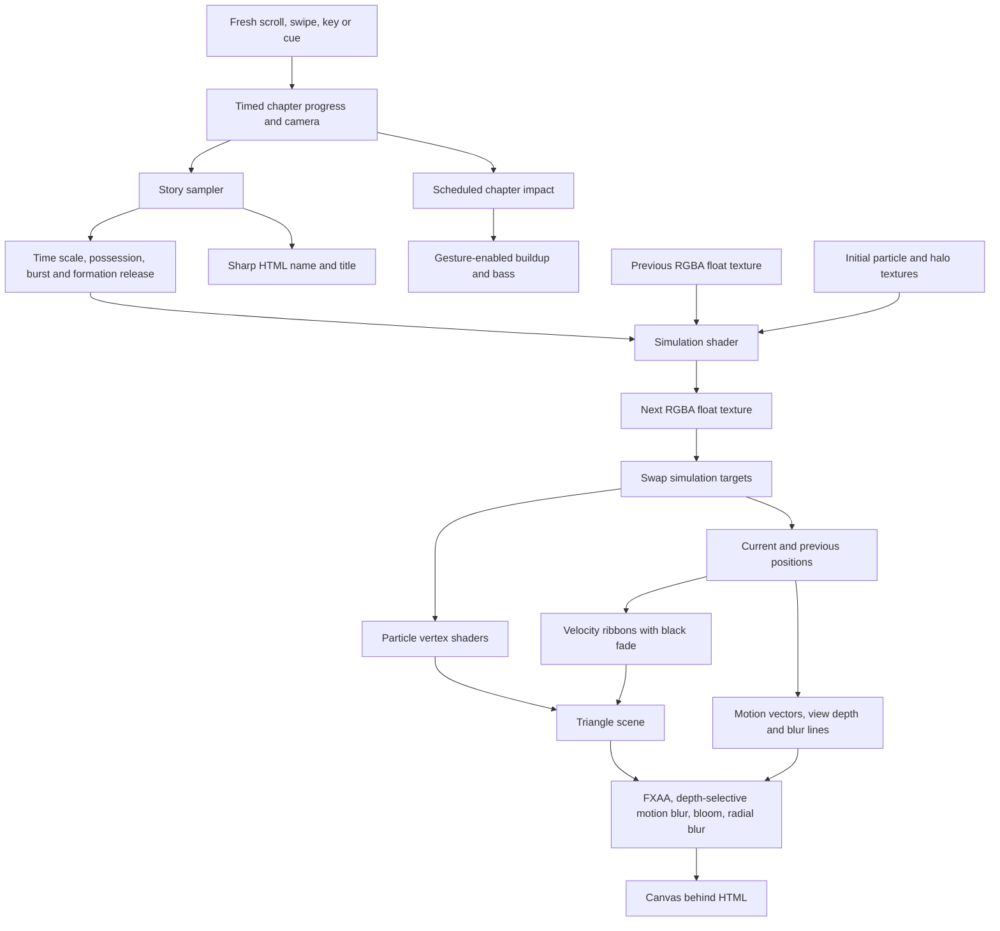

# Spirit engine reference

Spirit is a cinematic particle experience with four scroll chapters and a hold-triggered finale. Scroll, swipe, keyboard navigation or a cue tap triggers a timed transition; the transition completes independently, then holds its scene until a fresh gesture.
Particles arrive on an ivory stage with the name **MIRHAZAR KHAN**. The first forward gesture begins a three-second rush into dark slow motion, revealing **DARK MATTER**. With sound enabled, a rising sound builds toward a synchronized bass impact.
The next gesture begins a second three-second sequence: **DARK** wipes to the right and **MATTER** to the left, the halo releases early, and the fluid accelerates into a rush reaching 2.4× simulation speed. A branching red front spreads through the moving volume as the camera pushes closer. A synchronized bass impact brakes the stream into 0.12× slow motion, followed by an arc into the very close trailing view. Red heads retain short tails fading to black; the held camera then follows continuously with nearby particles sharp and farther particles blurred. This chapter has its own sharper buildup and deeper impact.
The next forward gesture gathers those same particles into a thick, silver living ring over 4.2 seconds. The camera arcs outward from the wake to reveal the complete hollow form. Particles circulate around the ring and roll around its tube while traveling ripples deform the surface and the whole shape tumbles. Surface-aware light produces bright silver edges and a darker interior. The held scene continues its motion without further input; scrolling upward releases the ring back into red flow. With sound enabled, an airy metallic rise resolves into a restrained low impact at 2.352 seconds.
At the settled silver ring, **CLICK AND HOLD** starts the supplied cinematic drum recording. The surface opens into connected red, violet and blue folds inspired by the new video. The main impact at 4.115 seconds releases a twisting radial burst; the same particles then assemble into a monumental two-line **DARK / MATTER** title with silver grain, surrounding dust and restrained flowing haze. Releasing before the impact unwinds to the ring; after the impact the reveal completes independently. A keyboard alternative can play the complete transformation without a sustained press. The final title holds until upward navigation or its return cue restores the ring.
The fixed interface contains a small Spirit signature, sound toggle, credits and contextual cue buttons. The scene holds are indefinite; the particle simulation remains alive.
This guide describes the source inspected on 2026-10-11.

## Verification scope

The hold revision passes 70 automated checks: 24 unchanged chapter checks, 18 mocked Web Audio checks, nine ring choreography checks and 19 hold-sequence checks. The hold checks exercise an authoritative audio clock, stale audio samples, direct jumps across impact/completion, early-release continuity, commitment at the exact impact, indefinite final holds, ring return, pause/resume, mute fallback, pulse onset sampling, reduced motion, immutable snapshots and bounded short/extreme clocks. The audio checks cover asset preload without an audio device, buffer decoding, resume offsets, natural completion, cancellation during download/decoding, mute, context loss, resource bounds and disposal. These are controller and mocked-device checks; actual shader compilation, rendered movement and audible synchronization require the live browser review.

The new production build passed. A hash comparison confirmed the local MP3 copy matches the supplied original, and the development server returned the asset with HTTP 200 and `audio/mpeg`. Scoped source review confirmed the preparation token and visibility/pause guards, frozen hidden-time clock, early-release audio cancellation, committed resume offset, touch-button hold with ordinary canvas swipes preserved, second-touch cancellation before commitment and reduced-motion camera/flash suppression. Live verification of this new finale was blocked when the browser-control tool rejected the localhost tab under its security policy with a protocol-not-allowed error. No bypass or alternative browser route was attempted. The new GPU shaders' rendered output, the audible recording/impact alignment, final wide/narrow visual framing and physical touch behavior therefore remain unverified. No new finale proof images are available. Earlier images below validate their earlier revisions only.

The previous ring revision passed 41 checks: 24 for the four-scene chapter controller, eight mocked Web Audio checks, and nine ring choreography checks. Ring tests cover conserved previous holds, continuous red-to-ring entry, 10,001 finite bounded gathering samples, no replay of previous visual envelopes, complete silver/formation at the held endpoint, reduced-motion suppression, invalid inputs, and 12,006 finite camera poses across wide and narrow aspects. A one-time comparison against the pre-ring sampler confirmed exact equality for every previous property at 20,002 normal/reduced samples over progress 0–1. Camera radius remains at least 670 world units and its gentle orbit retains the front-facing view. These checks verify CPU choreography and bounds; shader compilation and actual visual motion require the browser review.
The new production build passed. The ring rendered in the live in-app browser at 871×807 after a complete fourth forward scroll. It held exactly progress 1.5, formation 1, metallic reveal 1 and simulation scale 0.8, with a live ring clock and 670-unit camera radius. The shader compiled without errors. [cinematic-living-ring.jpg](cinematic-living-ring.jpg) captures the thick hollow silver form and bright glints; [cinematic-ring-convergence.jpg](cinematic-ring-convergence.jpg) captures its gathering. At 365×616 the complete silhouette fit without horizontal overflow, camera radius was 1029.48, and the ring clock advanced from 51 to 70 with visibly changing tumble between captures. Actual upward wheel input returned from scene four to exact progress 1 in 2.2 seconds, with full red possession, zero ring formation and the tail-follow camera restored. A fresh downward wheel input completed the 4.2-second convergence and held progress 1.5 with full silver and ring formation. [cinematic-living-ring-mobile.jpg](cinematic-living-ring-mobile.jpg) records that narrow replay. Browser error/warning logs were empty. This validates viewport framing and real wheel navigation; a physical touch device, measured frame rates and the audible mix remain unreviewed.
The ring's analytic GPU position sampler was also checked across 492,544 identities/times over 120 seconds. Its maximum distance from the form center was 220.17 units and its minimum hole radius in the unrotated principal plane was 60.60 units. Whole-form rotation can change the projected hole; these bounds verify the thick surface retains a physical opening rather than guaranteeing a circular hole from every camera angle.
The prior three-scene production build and browser review follow as historical evidence for the preserved chapters.
Live review in the active in-app browser at 871×807 confirmed that an actual wheel gesture completes the first three-second transition independently, and two rapid scroll gestures during it leave the app holding at exactly progress 0.5. A fresh wheel gesture completes the red chapter at progress 1, 0.12× simulation speed, full tail follow, a 78-unit gap, zero formation and full depth focus. Upward wheel input starts the 2.2-second return. At 365×616, clicking the first cue and immediately pressing Page Down twice also leaves Dark Matter holding at exactly 0.5 with transition ID 1. The narrow red scene holds at progress 1, 0.12× speed, full tail follow, an 89.41-unit gap, zero formation and full depth focus; its return cue starts the reverse chapter. Neither layout showed horizontal overflow. Sound activation worked in both layouts, with no app console errors or shader warnings observed. Current proofs are [cinematic-chapters-mobile.jpg](cinematic-chapters-mobile.jpg), [cinematic-chapters-red.jpg](cinematic-chapters-red.jpg) and [cinematic-chapters-red-mobile.jpg](cinematic-chapters-red-mobile.jpg). These narrow-screen checks exercised viewport layout, cue activation and keyboard input; they do not substitute for a physical touch-device test. The audible mix and device frame rates have not been independently assessed. The peeled `checkpoint-a` commit remains `814ea3b9c05cbd0204bc57bce92308338caa4483`.

The current kinetic revision passed its production build, all 25 automated checks, 10,001 phase samples and 40,004 camera poses. Comparing the previous sampler's properties through global progress 0.5 confirmed the original opening remains identical. Live review at 871×807 recorded the second simulation scale rising from 0.425 at 0.533 seconds to a 2.4× plateau between 1.183 and 1.733 seconds, then slowing through 1.589 at 1.950 seconds to 0.12× by 2.400 seconds. Formation was zero at 1.016 seconds, while red possession progressed from 0.209 at that time to 0.954 at 1.950 seconds and 1 at 2.167 seconds. [cinematic-red-fluid-rush.jpg](cinematic-red-fluid-rush.jpg) captures the moving curl field, streaks and forward camera travel at 1.016 seconds. At 365×616 with sound enabled, the second rush reached 2.4× at 1.347 seconds, with zero formation, red possession 0.498, travel 0.668, transition blur 1 and radial strength 0.85. [cinematic-red-fluid-rush-mobile.jpg](cinematic-red-fluid-rush-mobile.jpg) records that narrow-screen rush. The final three-second chase restored 0.12× speed, full red, zero transition blur, full depth focus and tail follow, with an 89.41-unit gap. The narrow review showed no horizontal overflow and empty browser error/warning logs. Sound opt-in worked; its audible mix remains unreviewed.

An earlier filter-focused section 2→3 blur iteration passed its production build, 25 checks and 10,001 pure progress samples. Live reviews at 871×807 and 365×616 confirmed peripheral streaks through its early wipe and full-red camera arc, with restored blur/focus values at the three-second hold, no horizontal overflow and empty error/warning logs. Its historical proofs are [cinematic-red-transition-blur.jpg](cinematic-red-transition-blur.jpg), [cinematic-red-arc-blur.jpg](cinematic-red-arc-blur.jpg) and [cinematic-red-transition-blur-mobile.jpg](cinematic-red-transition-blur-mobile.jpg). These captures predate the current 2.4× fluid rush, later red wave and synchronized brake; they do not verify the revised kinetic sequence.

Historical reviews before the timed chapter change follow. They validate retained visual behavior, rather than the new input controller or audio schedules.

The current tail-follow camera has been reviewed in source. Analytical checks cover 80,000 curved flow samples with finite poses, bounded history, exact pause behavior, vertical/stationary heading fallback and reset. Another 6,006 transition samples use the actual Three.js r74 quaternion implementation, including opposite and vertical headings; the spherical camera blend retains positive distance to its look target. The production build passed. Live review in the active in-app browser at 976×807 and 365×616 confirmed the close tail-follow view, sharp nearby heads and distant blur without console errors, shader warnings or horizontal overflow. Inspection reported tail-follow mode, full follow weight, 0.12× simulation speed, zero formation and full depth focus. The tail gap was 78 units at the wide size and 89.41 at the narrow size. With scroll position held still, the camera XYZ changed as the wake turned, confirming continuous tracking. Reverse scrolling restored the opening and the silver title. The current proof captures are cinematic-tail-follow.jpg and cinematic-tail-follow-mobile.jpg. The temporary viewport override was reset after testing. The previous close-flow implementation passed its production build and live in-app browser review at 1280×720 and 365×616 without console errors, shader warnings or horizontal overflow. It showed 0.12× simulation speed, zero formation, full depth focus, 52° elevation and 18° azimuth; its camera radius was 410 at the wide size and 607.56 at the narrow size. Keyboard scrolling back restored the silver title and ivory opening with the name. Those older captures, `cinematic-red-close.jpg` and `cinematic-red-close-mobile.jpg`, predate the current moving chase camera; the temporary narrow viewport was reset after testing. Pure checks for that earlier stage covered 10,001 timeline samples in both motion modes, composed camera framing at four aspect ratios, identical opening story samples to Checkpoint A through global progress 0.5, and exact red endpoints of 0.12× speed and zero formation. Additional checks covered simulation clocks, 10,001 triangle-rotation phases with constant area, depth reconstruction and blur shader composition. These checks do not measure frame rates across devices.
Checkpoint A passed its production build, 10,001 finite phase samples, 3,003 spherical camera poses, 160,016 composed camera poses across eight aspect ratios and both motion modes, and 823,296 fixed-identity possession masks for finite, bounded and monotonic values. Its camera pulled back during possession; the current camera instead moves into the released flow.
Before adding the red chapter, the live in-app browser rendered the GPU particles, opening name, surrounding blur and Dark Matter title. The opening and title were checked at 1440×900 and the sequence at 365×616, with no horizontal overflow at either size. Sound activation, credits and keyboard replay were exercised without new console errors.
Holding the original opening progress at 0.648 completed the impact beat: the title reached full opacity and the simulation reached 0.14× without further input. That position now maps to global progress 0.324. Earlier pure phase checks covered 10,001 progress samples and the timed beat; mocked audio checks covered unlock, cancellation, cooldown, voice limits and cleanup. These checks do not measure frame rates across devices or independently assess the audible mix.
Checkpoint A's possession and ascent rendered in the live in-app browser at 365×616 and 1440×900 without shader errors or horizontal overflow. Mid-transition captures show distinct silver and red regions as the front moves through the volume. At full scroll, inspection reported complete possession, 52° camera elevation and 18° azimuth; its upper view revealed the ring's opening and depth at both sizes. Those captures are `cinematic-possession-mobile.jpg`, `cinematic-possession.jpg`, `cinematic-red-ascent-mobile.jpg` and `cinematic-red-ascent.jpg` beside this guide. They predate the current close camera, released flow and depth-selective blur. Temporary desktop viewport overrides were reset after testing.
The earlier red chapter was also checked for opposing word transforms, blur and trailing shadows at both sizes; scrolling backward restored the title and silver palette. The settled red scene reached 0.82× speed with a fully completed wipe, sharp red heads and tapered tails. Its older captures, `cinematic-red-wipe-mobile.jpg`, `cinematic-red-wipe.jpg` and `cinematic-red-particles.jpg`, predate the spatial possession and upward camera arc. Run the production build after source changes and verify changes in a browser.
The retained [particle-forms.png](particle-forms.png) illustrates earlier target positions using a CPU projection; it is not a screenshot of this cinematic experience.

## Engine map

| File or directory | Responsibility | Useful extension point |
| --- | --- | --- |
| [src/index.js](../src/index.js) | Startup, scroll input, camera travel, choreography, interface, frame loop and teardown | App lifecycle and public control API |
| [src/core/sceneTimeline.js](../src/core/sceneTimeline.js) | Timed chapter playback, gesture rearming, endpoint holds and paused time | Scene durations and navigation |
| [src/core/holdSequence.js](../src/core/holdSequence.js) | Independent press/hold score clock, impact commitment, title reveal and reversible ring return | Hold timing and beat-driven visual envelopes |
| [src/core/cinematic.js](../src/core/cinematic.js) | Pure normalized-progress sampler, visual easing and simulation time scale | Visual envelopes and additional reveals |
| [src/core/cameraPath.js](../src/core/cameraPath.js) | Spherical camera ascent, side angle and aspect-aware framing | Camera choreography without changing the lens |
| [src/core/tailCamera.js](../src/core/tailCamera.js) | Bounded emitter breadcrumbs and a close chase pose along the wake | Following the stream without reading GPU particle positions |
| [src/core/sound.js](../src/core/sound.js) | Gesture-enabled Web Audio chapter scores, decoded hold soundtrack, synchronized clocks and resource cleanup | Sound design and additional cues |
| [src/core/settings.js](../src/core/settings.js) | Shared settings, target uniforms and hash parsing | Validated presets and quality profiles |
| [src/3d/morphTargets.js](../src/3d/morphTargets.js) | Deterministic cinematic halo, optional text, object and portrait targets | New forms and image sampling |
| [src/3d/simulator.js](../src/3d/simulator.js) | Float-texture simulation and target swapping | Force uniforms and simulation readiness |
| [src/glsl/position.frag](../src/glsl/position.frag) | Lifetime, respawn, attraction, curl, burst and formation | Force fields and emission patterns |
| [src/glsl/helpers/curl4.glsl](../src/glsl/helpers/curl4.glsl) | Curl field derived from noise | Original smoky movement |
| [src/glsl/helpers/ringPosition.glsl](../src/glsl/helpers/ringPosition.glsl) | Shared moving ring position and surface normal | Ring circulation, rolling, ripples and tumble |
| [src/glsl/helpers/chargedPosition.glsl](../src/glsl/helpers/chargedPosition.glsl) | Connected folded surfaces with a rolling red core and broad colored wings | Hold-phase movement and beat-driven expansion |
| [src/3d/particles.js](../src/3d/particles.js), [src/glsl/helpers/rotateParticle.glsl](../src/glsl/helpers/rotateParticle.glsl) | Points, simulation-time triangle rotation and matching motion materials | Particle appearance without collapsed geometry |
| [src/3d/particleTrails.js](../src/3d/particleTrails.js), [src/glsl/particleTrails.vert](../src/glsl/particleTrails.vert), [src/glsl/particleTrails.frag](../src/glsl/particleTrails.frag) | GPU velocity ribbons, depth handling and red-to-black tail shading | Particle tails without blurring their heads |
| [src/glsl/helpers/possessionMask.glsl](../src/glsl/helpers/possessionMask.glsl) | Shared radial/tendril possession front for particle heads and tails | Spatial palette changes through a moving volume |
| [src/3d/postprocessing/cinematic](../src/3d/postprocessing/cinematic) | Radial peripheral blur and subtle color separation | Surrounding motion treatment |
| [src/3d/postprocessing/afterglow](../src/3d/postprocessing/afterglow) | Restrained procedural silver haze and central impact light | Atmosphere around the particle-built final title |
| [src/3d/postprocessing](../src/3d/postprocessing) | Composer, anti-aliasing, motion vectors, depth-selective blur and bloom | Quality scaling and visual finish |
| [src/3d/fboHelper.js](../src/3d/fboHelper.js) | Full-screen shader passes and render targets | GPU buffer utilities |
| [src/3d/lights.js](../src/3d/lights.js) | Scene lighting | Light staging |
| [app/index.html](../app/index.html), [app/css/index.css](../app/css/index.css) | Fixed cinematic overlay, crisp typography, accessible cue buttons and scene announcements | Product presentation |
| [app/js/three.r74.min.js](../app/js/three.r74.min.js) | Global Three.js runtime | Version boundary for any migration |
| [src/libs/global_three/index.js](../src/libs/global_three/index.js) | Exposes global `THREE` to source modules | HTML script load order |
| [dev.js](../dev.js), [build.js](../build.js) | Development serving and production bundling | Build and preview behavior |

The actual global runtime is Three.js r74; the local package metadata says 0.73.0.
Source modules use that global runtime rather than loading a second Three.js implementation.
The HTML loads `three.r74.min.js` before `index.js`.
Custom shaders use version-specific chunks, so upgrading Three.js requires a deliberate material and postprocessing port.
The old dat.GUI shell, five-chapter `journey.js`, OrbitControls, floor and mobile warning module remain in the repository but are not used by the current entry point.

## Chapter choreography

The page occupies one fixed viewport and has no native scroll spacer. Wheel, touch and navigation keys choose an adjacent scene; they do not scrub the artwork. `sceneTimeline.js` owns normalized progress and reads a monotonic millisecond clock. The first two forward transitions last three seconds; the ring convergence lasts 4.2 seconds (`orbitDuration` is configurable). Reverse transitions last 2.2 seconds, and reduced-motion transitions last 0.4 seconds.
The stable endpoints are progress 0 for Arrival, 0.5 for Dark Matter, 1 for Red Matter and 1.5 for Living Ring. Progress travels linearly between these endpoints; `cinematic.js` supplies each effect's own smoothstep envelope. The original opening occupies progress 0–0.5, with `openingProgress = min(1, progress / 0.5)`. The second chapter uses `chapterProgress = max(0, (min(1, progress) - 0.5) / 0.5)` and `nextProgress = min(1, chapterProgress * 1.5)`. Its faster title wipe uses `nextProgress`; the fluid rush, release, red wave, brake and later camera handoff use the full chapter progression. The fourth scene uses `orbitProgress = max(0, (progress - 1) / 0.5)`; all prior visual fields remain saturated through this range, without replaying the opening or title.

Wheel events normalize line and page units to pixels. The controller accumulates 45 pixels in one direction to trigger a scene, caps each event at 240 pixels, and starts a new accumulation after 260 ms of quiet or a direction change. During a transition, input is discarded. Wheel timestamps are retained only to detect the end of inertia; they cannot queue another scene. After completion, rearming requires no held keyboard or touch contact and at least 260 ms without wheel input. A held key or finger therefore cannot advance twice. Restart and explicit seek also retain any recent wheel activity until its quiet period ends.
A touch swipe triggers at 46 pixels; release is required before another chapter. Adding a second finger ends the one-finger navigation contact so a pinch cannot leave a stale hold. Arrow Down, Page Down, End and Space move forward; Arrow Up, Page Up and Shift+Space move backward. Repeated keydown events are ignored, and Space on an ordinary control retains its native activation. Navigation is blocked while the credits panel is open and within editable controls. Contextual cue buttons provide equivalent tap and keyboard actions, and become available when the chapter is armed.

Each accepted transition reports its elapsed seconds, duration, direction, kind, impact time and monotonically increasing transition ID. Audio scheduling receives that same elapsed position. The first two forward impacts are at 1.92 seconds (64% of their transition), aligned with the rush-to-slow-motion brake. The red score retains its distinct timbre and uses a longer buildup to reach this later hit. The ring score resolves at 56% of its duration (2.352 seconds by default), during gathering and the red-to-silver reveal. Reverse transitions use a softer descending sound without a bass impact. A transition finishes with no additional input and holds the exact endpoint indefinitely; live particles, the tail-follow camera and the living ring continue moving in their respective scenes.

| Global progress | Implemented behavior |
| --- | --- |
| Arrival at the beginning | A 3.2-second particle arrival envelope reveals the centered two-line name on ivory. Reduced motion uses immediate arrival. |
| 0.030–0.150 | The name fades, moves upward and softens as the viewer departs. |
| 0.060–0.385 | A rush envelope accelerates the simulation and increases motion treatment; its entrance completes at 0.190 and its exit starts at 0.290. |
| 0.065–0.325 | The camera moves closer to the particle scene. Small pointer and ambient camera offsets provide parallax. |
| 0.120–0.300 | Background, fog and particle colors transition from ivory and ink to near-black and pale light. The rush reaches the dark stage before impact. |
| 0.320 | At 1.92 seconds of the first forward transition, a particle burst, brief camera impulse and bass impact share the chapter clock. |
| 0.310–0.400 | The opening envelope slows simulation toward 0.14 of normal frame time. |
| 0.330–0.450 | The opening envelope reveals the white **DARK / MATTER** heading. |
| 0.320–0.470 | Particles gather toward a tilted halo, with formation strength reaching 0.42. |
| 0.500 | The first transition ends and holds the fully revealed title. A fresh forward gesture begins the red chapter. |
| 0.513–0.700 | The title's wipe envelope moves **DARK** right and **MATTER** left; brief stretching, blur and trailing text shadows peak mid-wipe. Details fade earlier, and the words fade during the latter half of the wipe. |
| 0.525–0.670 | Halo formation releases from 0.42 to zero before the fluid rush peaks, freeing the original curl and attractor forces. |
| 0.560–0.885 | The second rush follows the opening's acceleration shape, peaks at 2.4× simulation speed over 0.690–0.790, and drives curl, emission radius, intensity, speed and attraction. Blur follows this actual fluid movement. |
| 0.565–0.825 | A dedicated travel envelope pushes the entry camera radius 31% closer after its aspect-aware framing is applied. |
| 0.590–0.860 | A radial, branching red front spreads through the moving volume. Possessed heads turn `#ff0204`, their lifetime fade becomes black, and short velocity ribbons appear. |
| 0.810–0.900 | The second brake reduces simulation from its rush toward 0.12×. The synchronized second bass impact falls at global progress 0.820, or 1.92 seconds into the chapter. |
| 0.790–1.000 | The camera arcs upward during the slowing portion. At 0.830 it begins rotating into the historical particle wake; at progress 1 it stays attached close behind the trailing stream. Formation stays zero; the settled scene blurs distant motion while nearby heads remain focused. The retained orbital path no longer determines the full-chase pose. |
| 1.000 | The red chase holds until a fresh forward gesture starts the ring convergence. The contextual cue becomes **SCROLL TO FORM**. |
| 1.010–1.440 | A positive-radius quaternion blend arcs the camera out of the wake toward a complete view centered on `(0, 50, 0)`. Narrow layouts pull back farther to preserve the silhouette. |
| 1.020–1.370 | A brief fluid acceleration and motion blur introduce convergence, then subside. The final living form moves at 0.8× simulation time rather than the 0.12× red chase. |
| 1.030–1.390 | `ringFormation` gathers the existing particle population continuously into the moving thick surface. Emitter attraction fades out; a little curl remains. |
| 1.140–1.430 | Red possession fades as metallic silver shading rises. Black velocity tails shorten while the ring becomes defined. |
| 1.280 | The restrained convergence impact shares the chapter clock at 2.352 seconds. |
| 1.500 | The completed ring holds with full formation and silver, no convergence rush or radial blur, continuous circulation/ripples/tumble and a gentle camera orbit. Upward input returns to the red scene. |

Forward transitions use a brief exponential visual impulse from the elapsed time since their scheduled impact. Reverse playback samples the visual envelopes backward without reversing particle simulation or replaying an impact. Returning to the opening permits a later fresh forward transition with a new score. Opening or reloading the page starts at Arrival; native browser scroll restoration does not choose a scene. Audio remains silent until enabled from the sound control or the ring's explicit hold gesture. A previous deliberate mute is respected by the hold.
Name and Dark Matter typography are HTML layers, so the title remains sharp while the surrounding canvas receives postprocessing.
The introduction can blur as it departs. Dark Matter's opposing departure uses its own HTML blur, leaving particle-head sharpness independent of the text treatment.

`cinematic.sample(progress, reducedMotion)` returns `progress`, `openingProgress`, `chapterProgress`, `nextProgress`, `departure`, `rush`, `darkness`, `reveal`, `timeScale`, `formation`, `travel`, `nameOpacity`, `wipe`, `red`, `arc`, `handoffRush`, `handoffBrake`, `handoffTravel`, `tailFollow`, `transitionBlur`, `orbitProgress`, `ringFormation`, `ringCamera`, `ringSilver` and `ringRush`.
It clamps progress to 0–1.5 and uses smoothstep easing.
The earlier optional impact-age override and progress-crossing rearm constants have been removed. Authored chapter timing controls completion and impact scheduling.
Within `nextProgress`, `wipe` eases over 0.04–0.60. On the full `chapterProgress`, `red` eases over 0.18–0.72; `handoffRush` enters over 0.12–0.38 and leaves over 0.58–0.77, matching the opening rush shape. `handoffBrake` eases over 0.62–0.80. The second simulation scale is `(0.14 + handoffRush * 2.26) * (1 - handoffBrake) + 0.12 * handoffBrake`, continuously entering from the 0.14× hold and reaching a 2.4× peak before settling at 0.12×. Reduced motion retains 0.16×.
Formation is multiplied by `1 - smoothstep(0.05, 0.34, chapterProgress)`, reaching zero before peak acceleration. `arc` eases over full chapter 0.58–1.00, and `handoffTravel` over 0.13–0.65.
During possession, the controller retains `closeUp = smoothstep(0.08, 0.85, red)`; reduced motion sets it to zero. `cameraPath.sample(distance, aspect, arc, closeUp, handoffTravel)` supplies the entry pose, blending its radius toward `max(410, 360 / max(0.4, aspect))`, then multiplying the resulting positive radius by `1 - handoffTravel * 0.31`. Applying this travel after framing keeps its forward push effective as red grows. The ascent uses `arc * 52°` elevation and `arc * 18°` azimuth. These values describe the entry/orbit helper, not the final chase camera.
The entry pose's look target blends from `(0, 50, 0)` toward `simulator.flowCenter` over red 0.12–0.85 and eases with a 650 ms response measured in simulation time. Camera position receives the same center offset. After the simulator advances, `tailCamera.update(flowCenter, simulationDt, aspect)` records the actual smoothed emitter and supplies an independent chase pose. The controller blends into that pose through `tailFollow = smoothstep(0.66, 1, chapterProgress)`; pointer and ambient parallax fade out with `1 - tailFollow`. The delayed handoff begins after the bass and brake, preventing the wake's moving aim from pulling the camera sideways at peak rush. The aim interpolates toward the chase aim. A quaternion rotates the normalized eye offset from its orbital heading to its chase heading while radius interpolates between positive distances, preventing the eye from crossing through the aim during the handoff. At full follow the eye uses the chase position directly, rather than adding the entry pose's centering delay a second time. The camera retains a 45° lens and vertical up vector.
The tail tracker records breadcrumbs at least 16 ms apart in simulation time and retains approximately 1.6 seconds. It interpolates a 1.0-second-old tail anchor, biased 18% toward the current emitter to reflect attraction. Samples aged 1.15 and 0.85 seconds define the forward tangent; its heading eases over 100 ms of simulation time and retains its last direction when the sampled displacement is too small. This older anchor places the eye behind a sparser part of the wake. Short initial history clamps to its available samples. No GPU readback or CPU particle-position reduction is used.
The eye sits 78 units behind that tangent, increasing to 92 on narrow screens, with 12 units of vertical lift and 9 units of lateral offset. It looks 50 units ahead of the anchor. The gap is the setback to the tail anchor, not the larger distance between eye and look-ahead target. Pausing holds history time and heading; teardown clears the history and resets its forward direction.
Reduced motion disables both rush envelopes, camera travel, ascent, tail follow, parallax and visual impulses, fixes the eye and aim, and sets simulation time scale to 0.16. Its brief transition retains color and title reveals; the title's next-scene departure becomes an opacity fade without horizontal travel, stretching or blur. Chapter sound scores are suppressed in this mode even when the sound toggle is enabled.
For the ring, `ringFormation` eases over orbit progress 0.06–0.78, `ringSilver` over 0.28–0.86 and normal `ringCamera` over 0.02–0.88. `ringRush` enters over 0.04–0.24 and exits over 0.48–0.74. Normal simulation scale becomes `0.12 + smoothstep(0.01, 0.64, orbitProgress) * 0.68 + ringRush * 0.60`; transition blur is `ringRush * 0.72`. At full formation, simulation is 0.8× and this extra blur is zero. Reduced motion keeps 0.16×, freezes `ringTime`, suppresses the rush and blur, and immediately selects the settled ring framing on entering its chapter, rather than performing a fast camera pullback.
`cameraPath.sampleRing(time, aspect, reducedMotion)` returns a pose around the ring's center with radius `max(670, 610 / max(0.35, aspect))`. Its azimuth is `0.14 + sin(time * 0.12) * 0.10` radians, elevation is `0.08 + sin(time * 0.16) * 0.025`, and time comes from the same scaled ring clock as the particles. Reduced motion fixes time to zero; invalid time/aspect inputs receive finite defaults. The controller blends the current chase offset to this direction with a quaternion and interpolates its positive radius, while the look target moves toward the scene center. Depth focus shifts to this ring radius and the distant-blur strength reduces as the full view arrives.

## Hold transformation and particle title

`holdSequence.js` owns a separate monotonic millisecond clock. It preserves the four existing chapter endpoints and pauses their navigation while preparing, holding, bursting, revealing or returning. `create({ impactAt, completeAt, reducedMotion, scoreOnsets })` exposes `begin(nowMs)`, `tick(nowMs, audioElapsedSeconds)`, `snapshot()`, `release(nowMs)`, `returnToRing(nowMs)`, `pause(nowMs)`, `resume(nowMs)` and `reset(nowMs)`. Its default exported impact is 4.115 seconds and completion is 7.615 seconds. `snapshot()` reads without advancing time. Only an idle, settled, armed ring accepts a new hold; repeated presses cannot restart an active sequence.

The states are `idle`, `holding`, `burst`, `revealing`, `complete` and `returning`. Snapshots report `active`, `committed`, `paused`, `elapsed`, `progress`, `awaken`, `awakenTime`, `scorePulse`, `burstFlash`, `titleFormation`, `titleBrightness`, `returnWeight`, `impactAt`, `completeAt` and a unique `sequenceId`. `active` remains true for the completed title so navigation cannot accidentally leave its underlying ring chapter. `returnWeight` is one during playback, eases toward zero during an unwind and is zero at idle. An early release freezes the current visual values and unwinds over 0.85 seconds. Releasing at or after the impact commits the sequence; completion needs no continued press. Returning from the completed title eases back over 1.2 seconds. Hidden time is excluded, invalid clocks cannot poison the visual fields, and stale media samples cannot reverse a committed impact or title morph.

While the recording plays, its decoded Web Audio clock is authoritative; the controller accepts a forward audio correction without replaying intervening events. If sound is muted or unavailable, the monotonic wall clock continues from the last sampled elapsed position. Completion caps visual progress at one while preserving elapsed time for the recording's 10.240-second decay. The formation begins 0.300 seconds after impact, reaches its exact title target 2.700 seconds after impact, and the completed state begins 3.500 seconds after impact. Beat onsets supplied through `scoreOnsets` create short exponential pulses without requiring analyser readback. Reduced motion retains these audio timings and gently morphs static forms, suppressing score pulses, kinetic burst flashes and moving camera choreography.

The GPU blends the moving ring into `chargedPosition.glsl`: a dense rolling red membrane surrounded by connected violet/blue wings, with circulating identities, folds and traveling ripples. At the impact, ring attraction releases over 0.24 seconds and a radial force plus tangential twist acts on the existing positions. Respawn preserves spatial history while the shape is charged, bursting or forming lettering, so the particle lifetime cannot teleport the ring population into a separate cloud. The camera eases to a frontal view, opens to accommodate the wider folded surface, then returns to the title framing. Motion vectors, radial blur and a restrained bloom/light impulse follow the burst.

`getCinematicTexture('finalTitle')` samples a heavy two-line **DARK / MATTER** silhouette using a locally available Impact/Arial Black font, with a bitmap fallback. Eighty-four percent of identities form the letters; the remaining sixteen percent become surrounding dust in the same simulation. The target scales with camera distance and aspect, keeping the taller stacked composition legible on narrow screens. Lettering retains a shallow depth and small living drift, while dust moves more broadly. An additional procedural haze pass supplies the flowing silver atmosphere inspired by the image references. The references are not pasted over the canvas. The small HTML caption **A new state of matter.** and hidden heading provide readable supporting text and an accessible title.

The UI announces preparation, the hold, the impact, title formation and ring return. Its circular progress mark reflects elapsed time toward the main impact. Mouse press on the artwork/cue, primary-touch press on the cue and Space hold are reversible; releasing before impact cancels the recording and unwinds. Touch presses on the ordinary canvas retain swipe navigation instead of beginning a hold, and a second touch cancels an uncommitted hold to preserve pinch behavior. Pressing Enter on the focused cue provides a complete-play alternative without requiring a sustained press. A pending asset preparation uses a generation token, so an early release, restart, page hide or disposal cannot start an abandoned transformation after decoding finishes. Audio enable/preparation callbacks recheck visibility and paused state before starting the recording. The scroll and navigation cues remain blocked during playback. At the completed title, upward navigation or **Return to the living ring** restores the ring; a later fresh upward gesture can return to the red chase.

## Rendering flow



Each simulation texel stores XYZ position and lifetime in RGBA.
Initial particle positions are generated once on the CPU.
Every active simulation frame, a full-screen fragment shader reads the previous state and writes the next state to a second float render target.
Expired particles respawn near the animated attractor, with their spawn positions blended toward the halo as formation increases.
Surviving particles receive attraction, curl displacement, a transient outward burst and a delta-adjusted pull toward the target while formation is active.
At zero halo/ring formation and burst, respawn, attraction and curl use the original Spirit equations without sampling target textures. The settled red settings return to the original speed, lifespan decay, spawn radius, curl scale and attraction; slow motion comes from simulation time rather than weakening those forces. During its rush, the controller temporarily broadens curl and emission while increasing simulation pace, then restores those original endpoints.
The buffers swap, so particle motion does not require CPU position uploads each frame.

The ring uses the existing particle identities and simulation textures. `ringPosition.glsl` hashes each texel's stable UV identity into an angle, tube angle and shell depth; it does not create a replacement mesh. Its initial principal plane is XY and its center is `(0, 50, 0)`. Major radius 140 has traveling 12- and 6-unit lobes, while tube radius 54 carries a 5-unit traveling wave and 4-unit breathing envelope. Additional 14- and 7-unit depth folds keep the surface organic. Particles circulate at 0.38–0.425 radians per ring-clock second, roll around the tube at 0.31, and the whole form turns around XYZ with slow sinusoidal precession.
`ringFormation` attenuates emitter attraction and the prior halo spring, reduces curl by 96% at full formation, and adds a frame-adjusted spring toward the moving ring: `(ringTarget - position) * (1 - exp(-0.20 * deltaRatio)) * ringFormation`. The spring runs after both surviving and expired-particle branches. At full ring, lifetime resets carry the previous live position rather than jumping to the attractor or across the hollow center. Lifetimes and reset bookkeeping remain active. `simulator.ringTime` advances only while formation is positive, using the supplied bounded simulation delta and `ringMotion`; pause freezes it, reduced motion sets `ringMotion` to zero, and disposal resets it.
Particle vertex shaders share the same analytic ring function to obtain surface normals and stable facet identity. The fragment shader blends into cool dark silver with view-space key/fill light, narrow glints and rim lighting; those highlights follow the form as it rolls. This is procedural particle shading, with no environment texture or external asset. Point and triangle geometry counts and their matching motion geometry remain unchanged.

Both points and triangle meshes are created at startup; the cinematic controller selects triangles throughout this sequence.
Triangle orientation rotates through a shared shader helper at a phase advanced by simulation time. Unlike interpolation between mirrored triangles, rotation preserves each triangle's area through every phase. Visible, distance and motion materials share that transform. Current/previous simulation positions also feed custom motion materials; paused simulation uses the same texture for both so stale velocities are not replayed.
The opening halo and ascending halo are lazily generated float textures matching the simulation dimensions, with stable seeded particle identity and constant alpha 1. Both consume the same random values, so matching texels represent the same particle in both targets.
The ascending target reflects the opening halo about `(0, 50, 0)` along the initial camera basis normal. With this entry point's initial camera basis, X/Y remain unchanged and Z is negated. `targetMix = red` retains this tilt transition while formation releases; by the camera ascent, target strength is zero and the view follows the natural flow.
Simulation lifetime remains separate from target alpha.
The controller uses an automatic attractor; pointer movement subtly offsets the entry camera rather than directly dragging particles, and fades away during tail follow. The simulator clamps its incoming simulation delta to 0–50 ms, uses it for noise time and attractor phase, and scales attractor interpolation by `1 - pow(0.8, deltaRatio)`. Movement, lifetime, noise, spawn oscillation, attractor, breadcrumbs and triangle rotation therefore slow together. `simulator.flowCenter` is a reference to the actual smoothed attractor uniform and is released on disposal.

The red transition is evaluated per particle in the GPU vertex shaders through the shared `possessionMask` helper. It measures weighted radial distance from `(0, 50, 0)`, adds two angular tendril waves and stable identity grain, and uses a narrow smoothstep band around each particle's arrival threshold. Its front distance is mapped through `(distance - 20) / 170` to spread the takeover across the actual halo radius. At the same chapter progress, inner lobes can be fully red while outer particles remain silver; the whole field does not pass through one uniform pink palette.
The mask is exactly 0 at possession 0 and exactly 1 at possession 1. It depends on live world positions, so fluid movement continues through the advancing front. A reverse chapter retracts the front. Heads and tails sample the same position and identity, keeping their possession state aligned.
The base head/fade uniforms retain the ivory-to-silver opening palette. Possessed heads instead use `possessionColor` with lifetime fade toward black. The controller does not globally interpolate those uniforms toward red.

`particleTrails` adds a stable subset of at most 32,768 GPU ribbons, each represented by two triangles. It reads the current and previous simulation textures directly, with no per-frame CPU position upload.
The vertex shader derives a camera-facing planar direction from particle displacement, normalizes against simulation delta relative to 16.6667 ms, multiplies displacement by 6 and caps tail length at 8 world units. In the red scene the controller limits tail strength to `red * 0.38`, preserving short black fades without covering the individual heads. Ring gathering multiplies this by `1 - ringFormation * 0.88`; possession also fades with the silver reveal, suppressing red ribbons in the completed silver form. Slow motion slows movement without removing the red scene's tails.
Ribbons sit 0.8 view-space units behind the head plane. They use normal alpha blending, depth testing and no depth writes; opaque particle heads retain their sharp silhouette and depth occlusion.
Tail color and opacity fade toward black and transparency, with soft side edges. Their color uniform shares `possessionColor` with the heads; their opacity is gated by both overall tail strength and each particle's possession mask, so a silver head cannot acquire a red tail ahead of the front.
Respawn lifetime jumps, displacements of 48 units or more and stationary particles suppress ribbons. Trails are hidden at zero simulation delta and release their references during scene teardown.

The composer runs enabled effects in this order: FXAA, supported motion blur, bloom, then cinematic radial blur.
Motion blur uses a nearest-filtered float motion/depth texture, so depth cannot interpolate into empty background. Its accumulation target uses float textures when float-linear filtering is available and an unsigned-byte fallback otherwise; a float-linear extension is no longer required to enable motion blur.
The radial pass samples toward the screen center more strongly at the perimeter, so movement concentrates in the surroundings.
Bloom becomes active as darkness passes 0.45 and uses the existing screen-blended softening pass; it is not selective HDR bloom.
During the next chapter, the opening's broad motion contribution, radial strength and bloom amount are multiplied by `sharpness = 1 - smoothstep(0.02, 0.45, red)`. Bloom clears early. The second transition blur now follows its real fluid rush, then adds a softer carry into the slowing arc: `arcBlur = smoothstep(0.58, 0.70, chapterProgress) * (1 - smoothstep(0.78, 0.98, chapterProgress)) * 0.55`, and `transitionBlur = handoffRush + (1 - handoffRush) * arcBlur`. The combined envelope stays within 0–1 and clears before the held endpoint. It adds up to 125 pixels of streak distance and 3.2 to the motion multiplier, matching the opening's rush strength; line opacity adds 0.24 times the envelope and is capped at 0.96. Cinematic radial strength is `min(1, openingRadial * sharpness + transitionBlur * 0.85)`, where `openingRadial` is the capped opening rush, progress velocity and impact contribution. The transition term is added after sharpness, so completed possession cannot remove it prematurely. Reduced motion sets this envelope to zero.
The motion texture stores actual nearest visible particle depth and an alpha occupancy mask. `depthWeight.glsl` reconstructs perspective view distance using the camera clip planes. The entry view eases the distant contribution from `max(40, entryRadius - 45)` to `entryRadius + 130`; these thresholds blend into chase focus as tail follow engages. Chase focus starts at `max(90, tailGap * 1.25)` and reaches full distant weight 150 units farther away. Depth protection uses `red * (1 - transitionBlur * 0.85)`, briefly allowing near-particle motion streaks during the move while retaining some foreground rejection. As the transition clears, full depth protection returns. In the settled red scene, nearby heads receive zero blur contribution; farther velocity vectors are multiplied by up to 7, streak distance settles to 16 pixels and line opacity settles to 0.6. The line shader also rejects distant streaks over foreground heads.
After motion compositing, a separate eight-tap pass softens distant particles with a 1.8-pixel radius. It retains sharp foreground silhouettes and rejects close-particle samples from distant blur taps. This treatment uses actual view depth, rather than screen-center distance. Motion history remains current during the chase and reverse chapters.
Reduced motion disables motion blur, bloom and radial blur.
FXAA remains enabled. Shadow maps are disabled in this cinematic version.
DOF and vignette modules remain available but are not wired into the sequence.
Resize updates the camera, canvas, composer buffers and effects through `effectComposer.resize`.

## Interface and settings

| Control | Implemented behavior |
| --- | --- |
| Scroll / touch swipe / navigation keys | Starts one timed adjacent-scene transition; transition input is discarded and a fresh gesture is required afterward |
| Contextual cue | Tappable and keyboard-accessible equivalent of forward navigation, or return from the living ring; hidden and disabled during transition and rearming |
| Living-ring cue | Red Matter offers **SCROLL TO FORM**; Living Ring offers **CLICK AND HOLD** and return to red matter. Press/hold the primary pointer or Space for a reversible transformation; Enter on its button provides complete playback. |
| Final title return | Upward scroll/navigation or its return cue first restores the living ring; a fresh later gesture can leave the ring |
| SPIRIT signature | Immediately resets to Arrival and cancels the active chapter score and hold recording |
| Sound off / on | Enables the audio context from a user gesture, or fades sound out |
| Information icon | Opens the credits and brief instructions |
| Close / Escape | Closes credits and returns focus to the information control |

Audio is off initially.
Importing `sound.js` does not create an audio device; clicking Sound or explicitly holding the ring invokes `enable()` and resumes the context if needed. A deliberate mute is retained across later holds.
At each accepted transition, `playTransition(kind, duration, impactAt, elapsed)` schedules the remaining score against the audio context's current time, using the chapter's elapsed position. Scheduled sources do not wait for a render frame to hit. The opening combines a smooth low tonal rise, filtered noise and a 96-to-34 Hz sine impact; the red chapter uses a sharper triangle-toned rise, brighter noise transient and a 128-to-28 Hz bass fall. The orbit chapter uses a lighter 220-to-1440 Hz triangle rise, a narrow airy noise sweep and a softer 80-to-24 Hz impact. A reverse transition has a restrained descending filtered-noise sweep. These synthesized layers require no media download.
Opting in or resuming before the impact schedules only the remaining buildup and future hit. Opting in after the hit does not replay it. `cancelTransition()` fades sounding sources over roughly 40 ms and immediately stops future scheduled sources. Pause, hidden tabs, restart, explicit seek and a lost graphics context cancel the active score; returning from pause or a hidden tab uses the unchanged chapter position to schedule what remains. Reduced motion suppresses chapter scores.
Disabling sound fades the master gain and cancels every active voice, so reenabling cannot reveal an abandoned future hit. Voice count is bounded. Teardown stops active sources, disconnects nodes and closes the context.
The hold uses the supplied [cinematic_drums_titanic_impact.mp3](../app/audio/cinematic_drums_titanic_impact.mp3), preserved locally under `app/audio/`. Its decoded duration is 10.240 seconds and its primary burst onset is 4.115 seconds. `preloadImpact()` may fetch its bytes once before a gesture without creating or decoding an audio device. `prepareImpact()` decodes only against an enabled context. Failed load/decode returns false and permits a silent visual sequence. `playImpactTrack(elapsedSeconds)` starts one buffer source at that exact offset, and `impactElapsed()` exposes its active audio clock. Natural completion releases its nodes and retains the finished elapsed value until cancellation; cancellation, mute or device loss clears that clock so the hold can use wall time. Pending downloads/decodes are generation-guarded and cannot restore abandoned playback. There is no unattended background soundtrack.

| Engine setting | Current controller ownership |
| --- | --- |
| `query.amount` | Desktop `65k`, mobile `16k`; valid hash values override either |
| `useTriangleParticles`, `followMouse` | true and false respectively |
| `intensity` | `0.65 + fluidRush * 0.3`, where `fluidRush = rush + handoffRush + ringRush`; only affects formation drift while formation is active |
| `speed` | `0.85 + fluidRush * 0.45 + red * 0.15`, then multiplied by simulation delta |
| `dieSpeed` | `0.012 + red * 0.003`, then multiplied by simulation delta |
| `radius` | `(0.9 + rush) * (1 - red) + originalRadius * red + handoffRush * (1 + red * 0.35)`; `originalRadius` is captured before overrides: 0.6 for 65k or 0.48 for 16k |
| `curlSize` | `0.019 - fluidRush * 0.004 + red * 0.001` |
| `attraction` | `0.8 - fluidRush * 0.5 + red * 0.2` |
| `burst` | Decaying impact impulse × 0.85 |
| Target textures / mix / strength | Opening halo to ascending halo, blend `red`, opening formation up to 0.42; releases over chapter 0.05–0.34 before the second rush peaks and stays zero during tail follow |
| Background / fog | `#f4f2ec` to `#07080d` |
| Base particle head / lifetime fade | `#777875` to `#bbc2d5`; fade color blends toward the dark background |
| `possession` / `possessionColor` | `red * (1 - ringSilver)` drives the per-particle front; possessed color is `#ff0204` with lifetime fade to black |
| Interface ink | `#15161a` to `#eeece7` |
| `tailStrength` | `red * 0.38 * (1 - ringFormation * 0.88)`; short ribbons capped at 8 world units |
| `ringFormation` / `ringMetallic` / `ringMotion` | Fourth-scene gathering, silver reveal and ring-clock enable; `ringMotion` is zero under reduced motion |
| `awaken` / `awakenTime` / `scorePulse` | Independent hold morph into the folded charged surface, score-relative form time and short beat pulses; reduced motion fixes form time and suppresses pulses |
| `titleTexture` / `titleAspect` / `titleFormation` / `titleBrightness` | Particle-built final title target, aspect-aware fit, convergence and silver-light reveal |
| `burstFlash` | Hold impact envelope drives actual radial/twisting displacement, stronger motion blur and brief light; zero under reduced motion |
| `fxaa` | Enabled |
| `motionBlur` | Enabled when supported and reduced motion is off |
| Motion-blur distance | `(16 + rush * 125 + impact * 24) * sharpness + red * 16 + transitionBlur * 125`, where `sharpness = 1 - smoothstep(0.02, 0.45, red)` |
| Motion-blur multiplier | `(0.35 + rush * 3.2 + progressVelocity * 1.5 + impact * 0.7) * sharpness + red + transitionBlur * 3.2`; velocity comes from authored progress, not user scroll speed |
| Depth blur / focus / gain | Strength `red * (1 - transitionBlur * 0.85) * (1 - ringCamera * 0.70)`; entry focus `max(40, entryRadius - 45)` to `entryRadius + 130` blends into chase focus `max(90, tailGap * 1.25)` to that value + 150, then ring focus `ringRadius - 30` to `ringRadius + 205`; distant motion gain 7; softening radius 1.8 pixels |
| Tail-follow camera | Blend `smoothstep(0.66, 1, chapterProgress)`; 1.0-second historical anchor, 18% current-emitter bias, 78–92 unit setback, 12 up, 9 side, 50 look-ahead |
| Blur-line opacity | `min(0.96, 0.9 - red * 0.3 + transitionBlur * 0.24)` |
| Blur-line target scale | 1/3 desktop, 1/4 mobile |
| Motion-vector target scale | 1 desktop, 0.65 mobile |
| `bloom` | Active after darkness 0.45 while `sharpness > 0.005`, then a restrained `ringSilver * 0.065` contribution in the silver reveal, unless reduced motion |

The header and scroll indicator inherit `--scene-ink`; the page inherits `--scene-paper`.
The controller writes those body variables each frame, alongside `data-chapter` (one-based settled chapter), `data-transition` (active kind or `holding`), `data-transition-id`, `data-transition-elapsed` (seconds), `data-timeline-progress`, `data-scene`, `data-motion-scale`, `data-title-wipe`, `data-particle-color`, `data-red-possession`, `data-camera-elevation`, `data-camera-azimuth`, `data-camera-radius`, `data-camera-mode`, `data-tail-follow`, `data-tail-gap`, `data-camera-position`, `data-formation` and `data-depth-focus` for inspection. `data-chapter` changes at transition completion; the visual `data-scene` can change while that transition is in flight. Camera elevation, azimuth and radius derive from the actual eye-to-aim offset, rather than the retained orbit helper; radius is not the smaller tail-anchor setback. `data-camera-position` contains the actual XYZ eye coordinates. During a mixed front, `data-particle-color` reports the base color; once red is complete it reports the possession color. `data-scene` becomes `red-tail-follow` and `data-camera-mode` becomes `tail-follow` when the follow weight exceeds 0.95.
`data-transition-blur` reports the additional second-chapter envelope, and `data-cinematic-blur` reports the final radial pass strength. Both return to zero in the settled red scene.
`data-fluid-rush` reports the combined opening, second-chapter and ring-convergence rush, while `data-handoff-travel` reports the second chapter's forward camera push.
`data-ring-formation`, `data-ring-silver` and `data-ring-time` expose the gathering weight, metallic reveal and scaled ring clock. `data-scene` becomes `ring-convergence` during the camera pullback and `living-ring` at nearly complete formation; `data-camera-mode` becomes `ring-orbit` at full ring framing. Ring output color reports the silver reference `#c3c6c8` after the metallic reveal, while actual shaded particles retain varying dark facets and white glints. The bottom progress indicator spans the entire 0–1.5 sequence.
`data-hold-state` reports preparation or the hold state; `data-hold-elapsed`, `data-hold-sequence`, `data-awaken`, `data-score-pulse`, `data-burst-flash` and `data-title-formation` expose its separate visual clock and weights. `data-impact-clock` distinguishes `audio` from the visual wall-clock fallback. During this branch, `data-scene` reports `charged-matter`, `matter-burst`, `matter-revealing`, `particle-title` or `ring-return`. `data-chapter` reports five once the title is fully formed while the underlying chapter progress remains 1.5; the scroll chapter controller has not gained a fifth endpoint.
Direct edits to story-owned settings are overwritten by the controller on the next frame.
Particle count changes through hash configuration and a reload, not through a live interface control.
The retained legacy blur-quality map is best 1, high 1/2, medium 1/3 and low 1/4; the controller sets its own scales.
Pixel cost scales with the square of a render target's linear resolution scale.

| Existing count label | Texture dimensions | Actual particle count |
| --- | --- | ---: |
| `4k` | 64 × 64 | 4,096 |
| `8k` | 128 × 64 | 8,192 |
| `16k` | 128 × 128 | 16,384 |
| `32k` | 256 × 128 | 32,768 |
| `65k` | 256 × 256 | 65,536 |
| `131k` | 512 × 256 | 131,072 |
| `252k` | 512 × 512 | 262,144 |
| `524k` | 1024 × 512 | 524,288 |
| `1m` | 1024 × 1024 | 1,048,576 |
| `2m` | 2048 × 1024 | 2,097,152 |
| `4m` | 2048 × 2048 | 4,194,304 |

`252k` is a mislabeled existing key; preserve saved-link compatibility if changing its display label.
The current startup allocates its opening and ascending halo textures plus the final title target, rather than allocating all five legacy morph textures.
Both geometry variants still consume memory even when one is hidden.
Rendering is capped to a maximum dimension of 1600 pixels, with mobile additionally limited to 0.8 of viewport resolution.
The canvas still fills the viewport.
Mobile enters directly at its default count without a warning gate; supported blur remains available.

## Public control API and retained extensions

`window.Spirit` exposes the current integration surface:

| API | Semantics |
| --- | --- |
| `setTimeline(progress)` | Immediately clamps and seeks to 0–1.5 without scrolling the page, cancels any active chapter/hold transition and score, and chooses the nearest chapter for subsequent navigation. Intermediate values are supported for integration inspection. The paused state is preserved. |
| `pause()` | Freezes particle simulation, chapter and hold clocks, blocks navigation and cancels active audio; an uncommitted press begins a frozen unwind; rendering continues |
| `resume()` | Resumes simulation and the same chapter/hold position; schedules only remaining audio cues when visible and resumes a committed hold recording from its offset |
| `settings` | Shared engine settings; story-owned values are reapplied each frame |
| `dispose()` | Cancels animation, removes listeners, releases graphics resources and stops audio |

There are no current `setScene()` or public `setPortrait()` methods. Cue buttons start adjacent chapters; there is no unattended scene advancement.
A public remount method, validated persistence and share-link serialization are not implemented.
Extend the current sequence through the endpoint and duration controller in `sceneTimeline.js`, visual envelopes in `cinematic.js`, and integration in `src/index.js`; `journey.js` belongs to the earlier five-scene implementation.

`morphTargets` exports `init()`, `getTexture(index)`, `getCinematicTexture(key)`, `setPortrait(image)`, `dispose()`, `labels`, `sceneMap` and `portraitSource`.
`getCinematicTexture()` lazily supports `name`, `darkMatter`, `halo`, `ascendingHalo` and `finalTitle`.
The current entry point uses both halo targets and the final stacked particle-title target. Optional earlier text targets remain available for other choreography. The ascending target's reflection uses the captured initial camera basis, so its projected silhouette is retained even with a differently oriented starting camera.
The retained legacy texture set contains Flow, Orbit, SPIRIT, Portrait and Infinity.
Its portrait setter accepts a decoded image/canvas-compatible source, replaces that target and disposes the previous texture; callers must refresh retained references.
The portrait sampler uses a centered, top-biased crop, bust mask, background suppression, edge detail and face-region density.
Nearly empty images fall back to an anonymous target.
The supplied [portrait.png](../app/images/portrait.png) is preserved for future scenes, but the cinematic controller neither loads nor displays it.

The target shader remains the extension point for alternate force fields, emission patterns, multiple attractors or audio-derived uniforms.
Keep new target dimensions consistent with the simulation textures and dispose replaced textures.
The sound module independently exposes `enable()`, `disable()`, `isEnabled()`, `playTransition(kind, duration, impactAt, elapsed)`, `cancelTransition()`, `preloadImpact()`, `prepareImpact()`, `impactReady()`, `playImpactTrack(elapsed)`, `impactElapsed()`, `cancelImpactTrack()`, retained `thump(strength)` and `dispose()`. `enable()`, preparation functions and `dispose()` return promises. Score durations, impact offsets and elapsed positions use seconds. Valid synthesized score kinds are `dark`, `red`, `orbit` and `return`. Calling `playTransition` replaces the preceding chapter score; it does not enable audio by itself. The current entry point does not use the standalone `thump()` helper.

## Lifecycle and production considerations

- Startup checks vertex texture access, float-texture support and a small float framebuffer before allocating the scene. Unsupported startup shows an inline error.
- Motion vectors use nearest-filtered floats; blur accumulation falls back to unsigned bytes when float-linear filtering is unavailable.
- GPU-positioned meshes disable CPU frustum culling so UV-based bounds do not hide the artwork.
- Motion materials receive both current and previous simulation textures.
- Render delta is capped at 50 ms; scaled simulation delta is clamped once to 50 ms before simulation, tail history, triangle rotation and trail normalization consume it. This keeps all physical consumers on the same bounded step, including during the 2.4× rush. Low frame rates cap the effective rush rate. Chapter playback uses the monotonic clock separately, so a slow frame does not stretch scheduled cinematic timing.
- Hidden tabs pause chapter/hold time, cancel active audio and animation, and reset frame timing on return. Resuming shifts the chapter clock by the hidden duration; elapsed progress does not jump forward. Losing a held contact cancels an early hold into its unwind; committed title playback retains its position and can resume the recording from that offset.
- `pause()` freezes particle simulation and chapter/hold playback. Navigation input cannot start another chapter until resumed. Rendering continues.
- Teardown resets tail-camera history and releases simulation/default textures, morph targets, scene geometry/materials, composer buffers, motion/bloom/radial effects and full-screen helpers, then removes the canvas and disposes sound.
- A lost WebGL context stops the loop and requests a reload; automatic reconstruction is not implemented.
- Build, minifier and output-write failures propagate a nonzero exit status.

Production review should inspect actual shader compilation, initial particle arrival, independently completed transitions, exact held endpoints, discarded wheel/key/touch input, fresh-gesture rearming and reverse chapters. Also inspect Dark Matter slow motion, opposing title wipes, the mixed silver/red front, short aligned black tails, the released flow at 0.12×, the later spherical handoff into the close tail-follow view, continuous attachment as the stream turns, narrow-screen framing, distant blur with sharp nearby heads, all three forward sound scores, mid-transition sound opt-in, cancellation and narrow/touch layouts. For the ring, inspect continuous gathering from the existing flow, preservation of its hollow center, rolling surface motion and tumble, moving silver glints, lifetime-reset continuity, outward camera handoff, full-form focus and reversible release into the red chase.
For the hold finale, inspect cue availability only at the settled ring, early release during preparation and folding, continued commitment after impact, the decoded audio clock and main hit, connected colored folds, the actual radial burst, stable letter formation, dust/haze, narrow title fit, Enter playback, Space/primary-touch hold, mute during playback, hidden-tab pause and return/replay. Controller tests cannot substitute for the audible mix or a physical touch-device review.
Profile the supported particle counts and viewport sizes before adding measured quality tiers or adaptive frame budgets.
The user-agent mobile heuristic and render-resolution cap are not a substitute for device measurements.
Validate repeated initialization/disposal with a real WebGL driver before treating the entry point as a reusable component.
Color interpolation retains frame-based smoothing and should be reviewed across refresh rates. Triangle rotation and the complete simulation clock now use scaled simulation time.

The credits name Mirhazar Khan for the experience, Edan Kwan for The Spirit and Simo Santavirta for the particle technique.
Preserve these credits and the copyright/permission notice in [LICENSE.md](../LICENSE.md) in distributed builds.

## Local commands

Run these from the repository root:

```text
npm run dev
npm run build
npm test
```

Development serves `app/` on localhost, starting at port 4000 and trying the next free port when necessary.
Set `PORT` to require a specific port; an occupied explicit port fails instead of silently changing it.
The preview bundles `src/index.js` on demand through glslify and invalidates its cached bundle when source files change.
Refresh the browser to see edits. Static responses send their complete content length and use `Cache-Control: no-store`.
Production writes `app/js/index.js`; preserve intentional working changes before replacing that generated asset.
Inspect the build result and confirm fresh output, then verify shader compilation and rendering in a browser.
